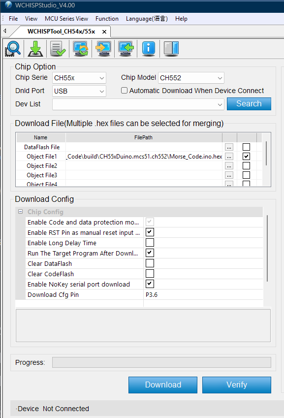

# CH552G CW Paddle to USB HID Keyboard

Custom firmware for a **CH552G-based USB-C / 3.5 mm TRS CW paddle adapter**. It reads a passive dual-lever iambic Morse paddle and sends ordinary USB keyboard keys:

| TRS contact | CH552G pin measured on test board | CH55xDuino pin | Output |
|---|---|---|---|
| Tip | Physical pin 3, P1.5 | `15` | `z` |
| Ring | Physical pin 4, P1.6 | `16` | `x` |
| Sleeve | Physical pin 14, GND | Ground | Common |

**Switch sense:** passive paddle shorts tip or ring to sleeve; internal pull-ups hold the inputs HIGH when released, LOW when pressed. These pin mappings were measured on **one particular adapter**. Check continuity before flashing a different CH552 board.

## Quick start: flash the ready-made HEX (recommended)

**No Arduino IDE or compiler needed.** Download the precompiled **[Morse_Code.ino.hex](https://github.com/mjwgeek/CH552G-CW-Paddle-USB-HID-/releases/download/Release/Morse_Code.ino.hex)** from the published **[Version 1.0 GitHub Release](https://github.com/mjwgeek/CH552G-CW-Paddle-USB-HID-/releases/tag/Release)**. The file is a release asset, **not** a file under the repository's `firmware/` source folders.

1. Install **[WCHISPTool for Windows](https://www.wch-ic.com/downloads/WCHISPTool_Setup_exe.html)** and its WCH USB bootloader driver, if prompted.
2. Open WCHISPTool and select **CH55x → CH552 → USB**. Uncheck **Automatic Download When Device Connect**.
3. Choose the downloaded `Morse_Code.ino.hex` in **Object File1**.
4. Unplug the adapter; hold its white **BOOT** button while connecting USB. Keep holding until WCHISPTool detects the CH552 (on the tested board: bootloader VID/PID `4348:55E0`).
5. Click **Download**. Do not disconnect during programming; release BOOT after programming begins. After success, disconnect and reconnect **without** holding BOOT.
6. Connect your passive paddle to the 3.5 mm jack: **tip → z**, **ring → x**, **sleeve → common**.

**WCHISPStudio / WCHISPTool screenshot:**



*Example of the WCH flashing software. The interface may look slightly different depending on the installed version.*

For a more detailed walkthrough and driver troubleshooting, follow **[Flashing with WCHISPTool](docs/FLASHING_WCHISPTOOL.md)**.

> The released HEX is offered as the ready-to-flash build. Its association with the tested hold-mode version is based on the uploaded release; this page does not independently verify the contents of the binary. Flashing replaces the factory firmware.

## Behavior and status

- **Hold mode (default, confirmed on the actual board):** key-down while a paddle contact is closed; key-up on release. Tested with Windows after reboot; CH552 USB keyboard transmission was also tested on Android and Linux. This is the right choice when software measures press duration.
- **One-tap mode (optional, not yet confirmed on the actual board):** 25 ms `z`/`x` keystroke on each new press, released even if the paddle stays closed. This avoids OS keyboard auto-repeat but *does not preserve held-key timing*.
- No letters are sent automatically when no paddle is pressed. The diagnostic `zxzxzx` firmware was only used during development and is **not** included as the default.
- The firmware is HID **keyboard-only**: no USB COM port is expected. The white button on the tested PCB puts the chip into USB **bootloader** mode during plug-in; it is not a paddle switch.
- Tested adapter hardware ran CH552 bootloader `2.50`; normal firmware enumerates using experimental VID/PID `1209:C55E`. This ID is not a universally assigned product identity. For commercial distribution, use identifiers assigned to your product.

## Files

```
firmware/hold/Morse_Code.ino             # validated press-and-hold paddle behavior
firmware/tap/Morse_Code.ino              # optional one-tap mode
usb-overrides/userUsbHidKeyboard/        # six CH55xDuino HID example source overrides
  USBconstant.c                          # standard 63-byte HID boot keyboard report, PID C55E
  USBconstant.h
  USBhandler.c
  USBhandler.h
  USBHIDKeyboard.c
  USBHIDKeyboard.h
tools/Prepare-Sketch.ps1                  # Windows assembly script
tools/prepare-sketch.sh                  # Linux/macOS assembly script
docs/FLASHING_WCHISPTOOL.md             # detailed flashing steps
docs/TROUBLESHOOTING.md
docs/WIRING.md
```

The USB helper sources require the `include/` and `usbCommonDescriptors/` headers from the installed CH55xDuino example. **Do not compile the six overrides by themselves.** The preparation scripts copy the whole official example `src/` tree and then overwrite the six files with the project's versions, leaving its dependencies intact. This makes the project follow your locally installed CH55xDuino core instead of copying headers from an unverified release.

## Software needed (Windows): ready-made HEX vs. compiling

**For the precompiled HEX, you only need WCHISPTool.** The Arduino IDE and CH55xDuino board package are optional, for building or modifying source:

| Software | Purpose | Official source |
|---|---|---|
| **Arduino IDE** *(optional)* | Compile the source code and export an Intel HEX firmware file | [arduino.cc/en/software](https://www.arduino.cc/en/software) |
| **CH55xDuino board package** *(optional)* | Add the CH552 board, compiler and USB HID example to Arduino IDE | [DeqingSun/ch55xduino](https://github.com/DeqingSun/ch55xduino) |
| **WCHISPTool (Windows)** | Flash the exported `.hex` into the CH552G over USB | [Official WCHISPTool download](https://www.wch-ic.com/downloads/WCHISPTool_Setup_exe.html) ([WCH tools catalog](https://www.wch-ic.com/downloads/category/30.html)) |

**You do not need Zadig, an external USB-to-serial adapter, a COM port, or a separate SDCC installation** for the documented Windows workflow. WCHISPTool's installer provides the manufacturer's bootloader driver on supported Windows systems. Changing bootloader USB drivers with Zadig can prevent WCHISPTool from detecting the chip.

### Install Arduino IDE and CH55xDuino (only for building from source)

1. Download and install Arduino IDE using the official link above.
2. In Arduino IDE open **File > Preferences** (on some platforms **Arduino IDE > Settings**).
3. In **Additional Boards Manager URLs**, add this exact address:

   ```text
   https://raw.githubusercontent.com/DeqingSun/ch55xduino/ch55xduino/package_ch55xduino_mcs51_index.json
   ```
4. Open **Tools > Board > Boards Manager**, search for **CH55xDuino** (or `ch55x`) and install the package.
5. Confirm **Tools > Board** now offers **CH552 Board**. CH55xDuino supplies the required HID keyboard example and compiler.

### Install WCHISPTool

1. Download **WCHISPTool_Setup.exe** from the official WCH link above (some versions distribute it in an archive).
2. Run its installer and install the included **WCH/CH375 USB driver** if prompted. Administrator approval may be required.
3. Start **WCHISPTool**. No serial/COM-port selection is required: this board is programmed in **USB** bootloader mode.
4. Follow [the illustrated step-by-step flashing guide](docs/FLASHING_WCHISPTOOL.md) below once you have the `.hex`.

## Build on Windows

1. Download or clone this repository.
2. In **Windows PowerShell**, run from the repository directory:

   ```powershell
   .\tools\Prepare-Sketch.ps1 -Mode hold
   ```

   For a one-tap firmware build instead, use `-Mode tap`. If PowerShell blocks scripts, use the manual assembly directions below instead of changing system policy.
3. Open `build\hold\Morse_Code\Morse_Code.ino` (or `build\tap\Morse_Code\Morse_Code.ino`) in Arduino IDE.
4. Configure **Tools**:
   - Board: `CH552 Board`
   - Clock Source: `16 MHz internal`
   - USB Settings: `USER CODE w/ 148B USB RAM`
   - Bootloader pin: `P3.6 (D+) pull-up`
   - Upload Method: `USB`
5. Select **Sketch > Verify/Compile**; then **Sketch > Export Compiled Binary**. The resulting `Morse_Code.ino.hex` should appear beside `Morse_Code.ino` in the prepared sketch folder. Alternatively, skip the build and download the ready-made file from the [Version 1.0 release](https://github.com/mjwgeek/CH552G-CW-Paddle-USB-HID-/releases/tag/Release).
6. Flash the HEX using [the WCHISPTool guide](docs/FLASHING_WCHISPTOOL.md).

> **Manual assembly:** Open the installed CH55xDuino `Generic_Examples > 05.USB > HidKeyboard` example, use **Save As** to create a sketch named `Morse_Code`, replace its `.ino` with the chosen `firmware/.../Morse_Code.ino`, then copy all six overrides into its `src/userUsbHidKeyboard/` directory (replacing those six files). Keep all of the original example's other `src/` directories intact. Compile and export the HEX as above.

## Build on Linux

After installing the same board core and finding the full path to its `HidKeyboard` example directory:

```bash
./tools/prepare-sketch.sh hold '/path/to/HidKeyboard'
```

Open `build/hold/Morse_Code/Morse_Code.ino` in Arduino IDE, choose the same settings, and export the HEX. The command can also use `tap` mode.

## Quick test

1. Unplug, then reconnect the adapter **without** holding its BOOT button.
2. Open a text editor and focus it.
3. Insert a passive paddle's 3.5 mm TRS plug.
4. Short tip to sleeve or hold the tip paddle: should send `z`.
5. Short ring to sleeve or hold the ring paddle: should send `x`.

On **hold mode**, Windows auto-repeat may create repeated characters after a key is held; the firmware is still sending one continuous key-down state. A CW trainer that understands key-down/key-up should ignore repeated keydown events. See [Troubleshooting](docs/TROUBLESHOOTING.md) for details.

## Attribution and licenses

This project incorporates six sources based on the `HidKeyboard` example of **[Deqing Sun's CH55xDuino](https://github.com/DeqingSun/ch55xduino)**. The upstream repository indicates **LGPL-2.1**; the copy of that license is in [`LICENSES/LGPL-2.1.txt`](LICENSES/LGPL-2.1.txt). These six files retain that upstream license, with modifications noted in [THIRD_PARTY_NOTICES.md](THIRD_PARTY_NOTICES.md). The new paddle sketches, docs, and preparation scripts are MIT-licensed (see [`LICENSE`](LICENSE)). Original CH55xDuino example sketch comments designate that example public domain.

This is an independent hobby project and is not affiliated with WCH or the CH55xDuino maintainer. **Flash at your own risk**; back up factory firmware first if it matters, since programming replaces it.