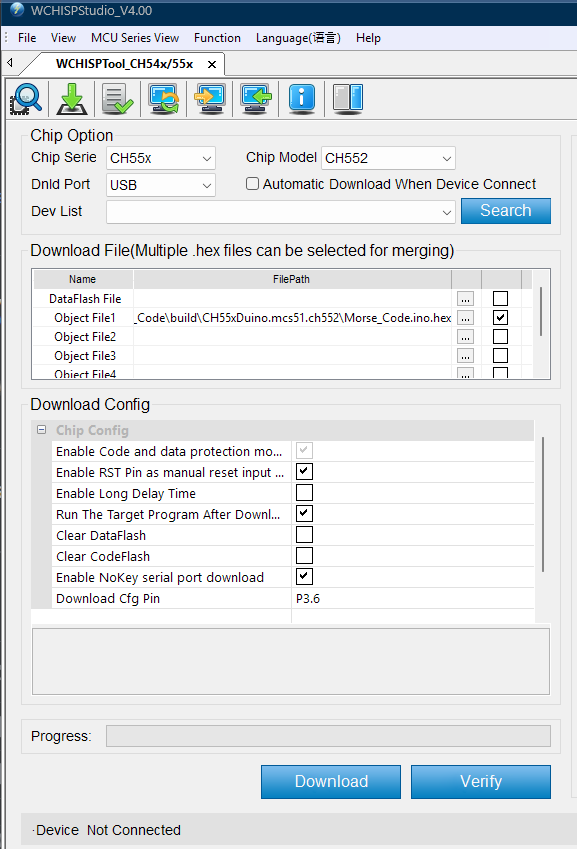

# Flashing a CH552G USB-C CW paddle adapter using WCHISPTool (Windows)

## Easiest method: use the precompiled release HEX

**Only WCHISPTool is required; Arduino IDE and CH55xDuino are not needed to flash a release.**

1. Download **[Morse_Code.ino.hex](https://github.com/mjwgeek/CH552G-CW-Paddle-USB-HID-/releases/download/Release/Morse_Code.ino.hex)** from the published **[Version 1.0 release](https://github.com/mjwgeek/CH552G-CW-Paddle-USB-HID-/releases/tag/Release)**. Save it somewhere easy to find, such as your Desktop or Downloads folder. The filename is intentionally `Morse_Code.ino.hex`.
2. Download and install **[WCHISPTool (official WCH website)](https://www.wch-ic.com/downloads/WCHISPTool_Setup_exe.html)**, allowing the WCH USB bootloader driver to install if prompted.
3. Start WCHISPTool, then continue at **[Step 1: Select device](#1-select-device-in-wchisptool)** below. Use the downloaded release HEX as **Object File1**.
4. **Do not** use the Arduino IDE **Upload** action. WCHISPTool does the flashing.

**Source build (optional):** To change the keyboard mapping or rebuild a HEX, follow [Step 0](#0-build-the-firmware-hex-in-arduino-ide-optional) below, then flash the newly compiled file in the same way.

## Required software and hardware (source building is optional)

**Software (only WCHISPTool is needed for the precompiled HEX):**

1. **Arduino IDE** *(optional, for compiling)*, from [Arduino's official download page](https://www.arduino.cc/en/software), is used to compile the firmware and export the `.hex` file. It is **not** used for uploading in these instructions.
2. **CH55xDuino** *(optional, for compiling)*, from [Deqing Sun's GitHub repository](https://github.com/DeqingSun/ch55xduino), adds `CH552 Board` and the SDCC toolchain to Arduino. In Arduino **File > Preferences > Additional Boards Manager URLs**, paste:

   ```text
   https://raw.githubusercontent.com/DeqingSun/ch55xduino/ch55xduino/package_ch55xduino_mcs51_index.json
   ```

   Then open **Tools > Board > Boards Manager**, find **CH55xDuino**, and click **Install**.
3. **WCHISPTool**, from [the official WCH download page](https://www.wch-ic.com/downloads/WCHISPTool_Setup_exe.html) (alternatively [WCH Tools](https://www.wch-ic.com/downloads/category/30.html)), is used to program the chip. Download **WCHISPTool_Setup.exe**, run the installer, and allow the manufacturer's **CH375/CH55x USB bootloader driver** installation when prompted.

**Hardware:** a CH552G-based USB-C/3.5 mm adapter with a white **BOOT** button, data-capable USB cable, and an external passive CW paddle. The measured tip/ring/GND mapping is specific to the tested adapter.

**Not needed:** Zadig, COM port, USB serial adapter, a separate SDCC install. Do not use Zadig to replace the CH552 bootloader driver when programming with WCHISPTool.

## 0. Build the firmware HEX in Arduino IDE (optional)

1. Download/clone this GitHub project. From PowerShell opened in the extracted repository folder, run ` .\tools\Prepare-Sketch.ps1 -Mode hold ` (or `-Mode tap` for the optional unverified one-tap mode). If script execution is blocked, use the manual copy instructions in the [README](../README.md).
2. Open the generated `build\hold\Morse_Code\Morse_Code.ino` in Arduino IDE.
3. Under **Tools**, set Board = **CH552 Board**; Clock = **16 MHz internal**; USB Settings = **USER CODE w/ 148B USB RAM**; Bootloader pin = **P3.6 (D+) pull-up**; Upload Method = **USB**.
4. Choose **Sketch > Verify/Compile**, then **Sketch > Export Compiled Binary**.
5. Verify `Morse_Code.ino.hex` is present in the prepared sketch directory (next to the `.ino`). Example path:

   ```text
   C:\...\CH552G-CW-Paddle-USB-HID\build\hold\Morse_Code\Morse_Code.ino.hex
   ```

   **Use Export Compiled Binary, not the Arduino Upload button.** Our tested Windows setup programmed reliably with WCHISPTool even when Arduino's own uploader failed.


## 1. Select device in WCHISPTool

Open WCHISPTool and select:

| Setting | Value |
|---|---|
| Chip Serie | `CH55x` |
| Chip Model | `CH552` |
| Download Port | `USB` |
| Automatic Download When Device Connect | **Unchecked** |
| Run The Target Program After Download | **Checked** |
| Enable NoKey serial port download | Leave default; not needed for this BOOT-button procedure |

**Application screenshot:**



*Screenshot provided with this project. Use the settings in the table above; labels and layout may vary by WCHISPTool / WCHISPStudio version.*

## 2. Load firmware

- At **Object File1**, click the `...` browse button.
- Select either the **downloaded release** `Morse_Code.ino.hex`, or the one you exported yourself from Arduino.
- Do not select the `.elf`, `.mem`, `.lk`, `.map`, or `.ino` files.
- Leave DataFlash and other object-file slots empty unless your device-specific tool explicitly requires them.

## 3. Enter ROM bootloader

1. Unplug the adapter from USB.
2. Hold down the **white BOOT button** on the adapter PCB.
3. While keeping it held, plug the adapter into the PC.
4. Confirm WCHISPTool says approximately `CH552 USB Port Connected`, chip `CH552`, bootloader `BTVER:02.50` (version can differ).

The bootloader appears as **VID `4348`, PID `55E0`** on the tested board. This is different from the normal keyboard VID/PID.

## 4. Program

1. With the bootloader connected, click **Download**.
2. Keep BOOT held until programming has started; release when it is under way or finished.
3. Wait for the tool's erase/write/verify process to show success. Do **not** disconnect while it is writing.

## 5. Test

1. Unplug the adapter and plug it back in normally **without holding BOOT**.
2. Open Notepad, focus the text area and connect the external CW paddle to the 3.5 mm TRS jack.
3. Operate tip paddle (`z`) and ring paddle (`x`). In **hold mode**, the character may auto-repeat if held because Windows repeats held keys. In **tap mode**, only a brief tap should be sent on each physical press.

Expected normal USB device: `CH55xduino` HID Keyboard Device at `1209:C55E`, **not a COM port**.

## Driver tip

If WCHISPTool can no longer detect the bootloader after using **Zadig**, a libusb driver may have replaced WCH's `CH375_A64` driver for `4348:55E0`. Reinstall/restore the WCH bootloader driver from the official WCH installer before using WCHISPTool. Do not change the normal keyboard driver (`hidusb.sys` / `kbdhid.sys`) unnecessarily. A Windows reboot may be needed if the new HID keyboard enumerates but does not type; the tested adapter started working on Windows after a reboot, although it was already working on Linux and Android.